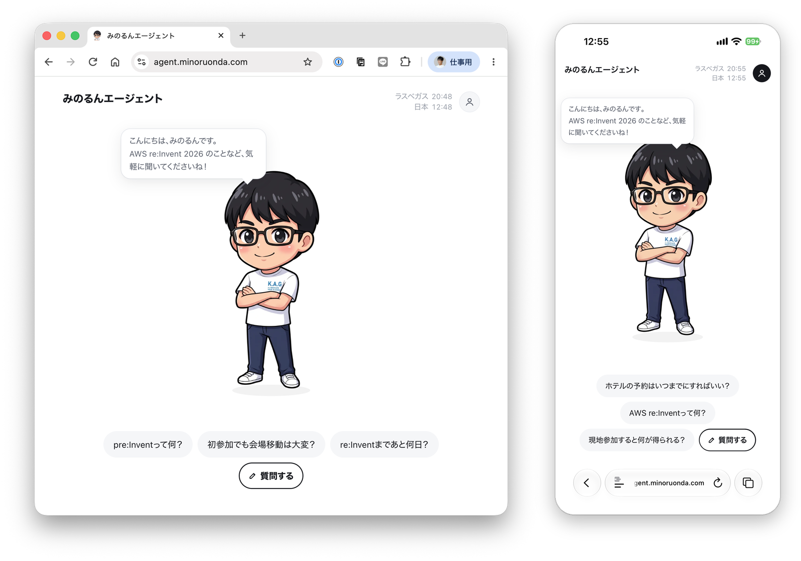
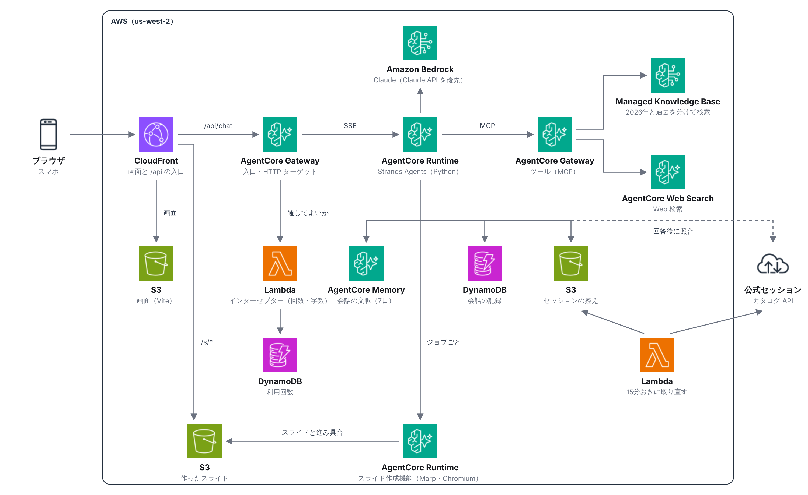

# みのるんエージェント

みのるんエージェントは、AWS re:Invent 2026 に日本から参加する人の質問に日本語で答える AI エージェントです。

re:Invent 2026 は、2026年11月30日（月）から12月4日（金）までラスベガスで開催されます。スマホのブラウザで https://agent.minoruonda.com を開けば、ログインなしで試せます。



このリポジトリはアプリの作りを読むためのものです。ナレッジベースに入れる知識のデータは含まれていません。

## 主な機能

- 準備・移動・会場・食事・ホテルなど、現地参加の実務に関する質問に答えます
- 2026年の情報と過去の参加記を分けて調べ、回答の中でも年を区別します
- セッションの日時や部屋は、公式カタログと照らし合わせてから伝えます
- 案内板・スライド・エラー画面の写真など、画像を1枚添えて質問できます。画像は回答するときだけ使い、保存しません
- 会場の場所を聞かれたら、キャンパスマップを吹き出しの中に出します
- 回答には出典を添え、次に聞きそうな質問の候補も出します

## アーキテクチャ



画面は S3 に置き、CloudFront で配信しています。質問は CloudFront から AgentCore Gateway を経由し、エージェント本体の AgentCore Runtime に渡されます。

Gateway には Lambda のインターセプターを付けており、利用者ごとの質問回数と文字数を数えています。上限を超えた質問は、エージェントを呼ぶ前にその場で断ります。

エージェントは、ナレッジベースと Web 検索をもう1つの AgentCore Gateway 経由で呼び出します。ナレッジベースで2026年の情報と過去の情報のどちらを検索するかは Gateway 側で固定してあり、エージェントから渡せるのは質問文だけです。

記事の URL や調べたテーマからスライドを作れます。上限はログインなしで1日1本、Google でログインすると1日2本です。エージェントのツールが回数を数えてから、スライド作成機能を別の AgentCore Runtime としてジョブごとのセッションで起動します。スライド作成機能はスライドの生成を AgentCore Harness のエージェントに任せます。このエージェントが Marp と Chromium で画像を書き出して余白を測り、出力した画像を確認しながら修正します。アーキテクチャ図は diagrams で描き、挿絵は各自が S3 に用意した画像一式から選びます。スライド作成機能は受け取った成果物をあらためて検査してから S3 に保存します。

良いスライドを書くための指示やスキルは `slides/core/` に分けてあり、公開版には動かすための見本だけを入れています。`slides/core/README.md` を参考に、自分のスライドの規則に書き換えて使ってください。できたスライドは CloudFront の /s/* から開けます。

モデルは Claude API を先に呼び出し、使えないときだけ Amazon Bedrock に切り替えます。回答とスライドを合わせた今月の Claude API の使用額が上限に近づいたら、使い切る前に回答もスライド作成機能も Bedrock へ切り替えます。

設計の要点は [docs/design.md](docs/design.md) にまとめてあります。

## 使っている技術

| 部分 | 技術 |
|---|---|
| エージェント | Strands Agents（Python） |
| モデル | Claude Sonnet 5.5（回答）、Claude Opus 5.5（スライド）、Claude Haiku 5.5（補助） |
| 実行基盤 | Amazon Bedrock AgentCore（回答とスライド作成機能の2つの Runtime、スライドを書く Harness） |
| スライド | Marp CLI、Chromium、diagrams（Graphviz） |
| 知識 | Amazon Bedrock Managed Knowledge Base |
| 画面 | TypeScript、Vite |
| インフラ | AWS CDK、[cdkd](https://github.com/go-to-k/cdkd) |

## フォルダ構成

| フォルダ | 中身 |
|---|---|
| agent | エージェント本体 |
| infra | CDK のスタック、Lambda、スクリプト |
| web | 画面 |
| knowledge | ナレッジベースの元を作るスクリプト |
| tests | 単体テストと通しのテスト |

知識の形式は [knowledge/README.md](knowledge/README.md) に書いてあります。

## セットアップ

us-west-2 で動かす前提です。WAF と証明書だけは CloudFront の仕様上、us-east-1 に作ります。AWS の認証は AWS_PROFILE で渡します。

デプロイ先の環境に合わせて、次の環境変数を使います。

| 環境変数 | 使う場面 |
|---|---|
| ALERT_EMAIL | 予算とアラームのメール送信先 |
| USAGE_PAGE_ORIGIN | 利用量の JSON を読むダッシュボード |
| APP_DOMAIN、HOSTED_ZONE_ID、DNS_PROFILE | 独自ドメインの証明書と DNS |
| GOOGLE_CLIENT_ID、APP_URL | Google ログイン |
| VITE_AUTH_DOMAIN、VITE_AUTH_CLIENT_ID | 画面のビルド |
| ENTRY_URL | 測定と通しのテスト |

Google ログインを使わなければ、ログインなしで動きます。

最新情報が必要な質問は Brave Search で調べます。先に AgentCore Identity で brave という名前の API キー用資格情報を作り、Brave Search の API キーを登録しておきます。

実行時の設定は [docs/local-configuration.md](docs/local-configuration.md) を参照してください。

初めて環境を構築するときは、次の順に実行します。

1. knowledge/sources に知識を置き、ナレッジベースの元データを書き出す

   ```sh
   python3 knowledge/tools/build_kb.py
   ```

2. ナレッジベースと検索用の Gateway を作る

   ```sh
   npx cdkd deploy MinorunKnowledge
   ```

3. ナレッジベースを取り込み、セッション情報の控えを取る

   ```sh
   uv run --with boto3 python infra/scripts/knowledge.py ingest
   uv run --with boto3 python infra/scripts/knowledge.py sessions
   ```

4. スライド作成機能を作り、続けてエージェント、入口の Gateway、WAF を作る

   ```sh
   npx cdkd deploy MinorunSlides
   npx cdkd deploy MinorunAgent MinorunEntry MinorunEdge
   ```

5. 独自ドメインの証明書を取得する。独自ドメインを使わない場合はこの手順を飛ばす

   ```sh
   uv run --with boto3 python infra/scripts/domain.py cert
   ```

6. 画面をビルドして配信し、独自ドメインを向ける

   ```sh
   npm run web:build
   npx cdkd deploy MinorunWeb
   uv run --with boto3 python infra/scripts/domain.py alias
   ```

7. ダッシュボード、アラーム、オンライン評価を作る

   ```sh
   npx cdkd deploy MinorunWatch
   ```

この手順は作者の環境で使っているものです。環境変数に置き換えた部分は、このリポジトリの状態のままでは通しで動作確認していません。

## 手元での確認

画面だけを手元で確認するときは、次のコマンドで開発サーバーを起動します。質問は API_ORIGIN に指定した入口へ中継されます。

```sh
API_ORIGIN=https://<独自ドメイン> npm run web:dev
```

アーキテクチャ図を描き直すときは、次のコマンドを実行します。rsvg-convert が必要です。

```sh
python3 docs/images/architecture.py
```

## ライセンス

コードは Apache License 2.0 です（[LICENSE](LICENSE)）。Copyright Minoru Onda.

キャラクターの絵はこのライセンスの対象外です。web/public/chara の画像、OGP 画像、アイコン、画面のスクリーンショットが該当します。作者の許可なく再利用しないでください。
