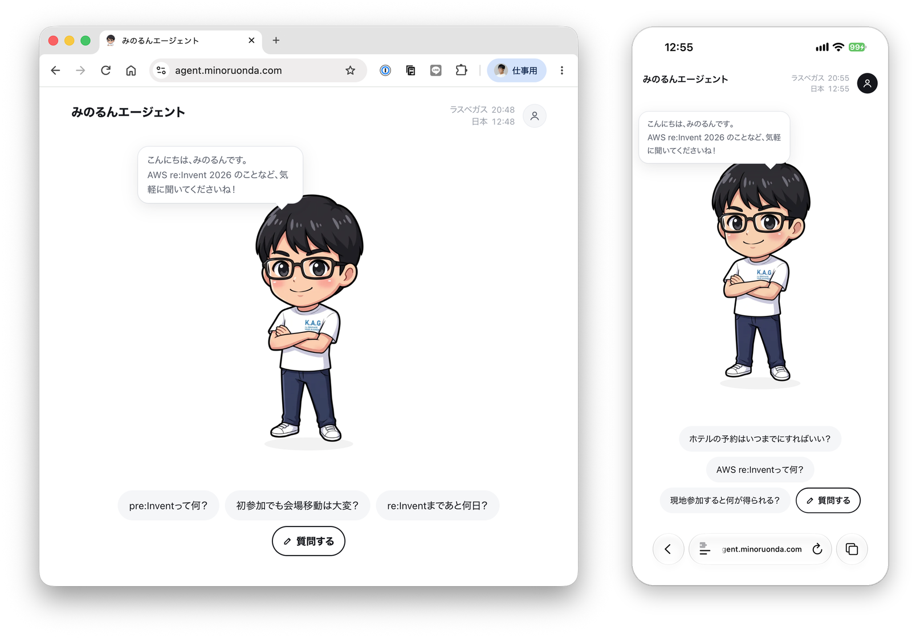
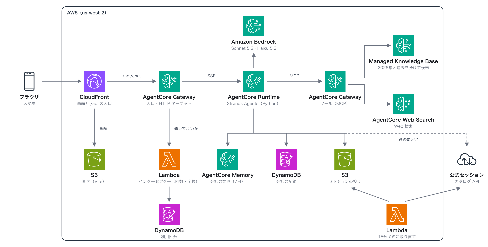

# みのるんエージェント

みのるんエージェントは、AWS re:Invent 2026 に日本から参加する人の質問に、日本語で答える AI エージェントです。

re:Invent 2026 は、2026年11月30日（月）から12月4日（金）までラスベガスで開かれます。スマホのブラウザで https://agent.minoruonda.com を開けば、ログインなしで試せます。



このリポジトリは、アプリの作りを読むためのものです。知識ベースに入れる知識の中身は入っていません。

## 主な機能

- 準備・移動・会場・食事・ホテルなど、現地参加の実務の質問に答えます
- 2026年の情報と過去の参加記を分けて調べ、答えの中でも年を区別します
- セッションの日時や部屋は、公式カタログと照らし合わせてから伝えます
- 会場の場所を聞かれたら、キャンパスマップを吹き出しの中に出します
- 回答には出典を添え、次に聞きそうな質問の候補も出します

## アーキテクチャ



画面は S3 に置き、CloudFront で配信しています。質問は CloudFront から AgentCore Gateway を通り、エージェント本体の AgentCore Runtime へ届きます。

Gateway には Lambda のインターセプターを付けていて、利用者ごとに質問の回数と文字数を数えています。上限を超えた質問は、エージェントを呼ぶ前にその場で断ります。

エージェントは、知識ベースと Web 検索を、もう1つの AgentCore Gateway 越しに呼びます。知識ベースを2026年の情報で引くか、過去の情報で引くかは Gateway 側で固定してあり、エージェントから渡せるのは質問文だけです。

作りの要点は [docs/design.md](docs/design.md) にまとめてあります。

## 使っている技術

| 部分 | 技術 |
|---|---|
| エージェント | Strands Agents（Python） |
| モデル | Claude Sonnet 5.5、Claude Haiku 5.5 |
| 実行基盤 | Amazon Bedrock AgentCore |
| 知識 | Amazon Bedrock Managed Knowledge Base |
| 画面 | TypeScript、Vite |
| インフラ | AWS CDK、[cdkd](https://github.com/go-to-k/cdkd) |

## フォルダ構成

| フォルダ | 中身 |
|---|---|
| agent | エージェント本体 |
| infra | CDK のスタック、Lambda、スクリプト |
| web | 画面 |
| knowledge | 知識ベースの元を作るスクリプト |
| tests | 単体テストと通しのテスト |

知識の形式は [knowledge/README.md](knowledge/README.md) に書いてあります。

## セットアップ

us-west-2 で動かす前提です。WAF と証明書だけは、CloudFront の決まりで us-east-1 に作ります。AWS の認証は AWS_PROFILE で渡します。

デプロイ先の環境に合わせて、次の環境変数を使います。

| 環境変数 | 使う場面 |
|---|---|
| ALERT_EMAIL | 予算とアラームのメールの送り先 |
| USAGE_PAGE_ORIGIN | 利用量の JSON を読むダッシュボード |
| APP_DOMAIN、HOSTED_ZONE_ID、DNS_PROFILE | 独自ドメインの証明書と DNS |
| GOOGLE_CLIENT_ID、APP_URL | Google ログイン |
| VITE_AUTH_DOMAIN、VITE_AUTH_CLIENT_ID | 画面のビルド |
| ENTRY_URL | 測定と通しのテスト |

Google ログインを使わなければ、ログインなしで動きます。

鮮度が要る質問は Brave Search で調べます。先に AgentCore Identity で、brave という名前の API キーの資格情報を作り、Brave Search の API キーを入れておきます。

実行時の設定は [docs/local-configuration.md](docs/local-configuration.md) を参照してください。

初めて作るときは、次の順に実行します。

1. knowledge/sources に知識を置き、知識ベースの元を書き出す

   ```sh
   python3 knowledge/tools/build_kb.py
   ```

2. 知識ベースと、検索用の Gateway を作る

   ```sh
   npx cdkd deploy MinorunKnowledge
   ```

3. 知識ベースを取り込み、セッション情報の控えを取る

   ```sh
   uv run --with boto3 python infra/scripts/knowledge.py ingest
   uv run --with boto3 python infra/scripts/knowledge.py sessions
   ```

4. エージェント、入口の Gateway、WAF を作る

   ```sh
   npx cdkd deploy MinorunAgent MinorunEntry MinorunEdge
   ```

5. 独自ドメインの証明書を取る（独自ドメインを使わないなら飛ばす）

   ```sh
   uv run --with boto3 python infra/scripts/domain.py cert
   ```

6. 画面を作って配信し、独自ドメインを向ける

   ```sh
   npm run web:build
   npx cdkd deploy MinorunWeb
   uv run --with boto3 python infra/scripts/domain.py alias
   ```

7. ダッシュボード、アラーム、オンライン評価を作る

   ```sh
   npx cdkd deploy MinorunWatch
   ```

この手順は作者の環境で使っているものです。環境変数へ置き換えた部分は、このリポジトリの形のままでは通しで試していません。

## 手元での確認

画面だけを手元で確かめるときは、次のコマンドで開発サーバーを起動します。質問は API_ORIGIN に入れた入口へ中継されます。

```sh
API_ORIGIN=https://<独自ドメイン> npm run web:dev
```

アーキテクチャ図を描き直すときは、次のコマンドを実行します。rsvg-convert が必要です。

```sh
python3 docs/images/architecture.py
```

## ライセンス

コードは Apache License 2.0 です（[LICENSE](LICENSE)）。Copyright Minoru Onda.

キャラクターの絵はこのライセンスの対象外です。web/public/chara の画像、OGP 画像、アイコン、画面のスクリーンショットが当たります。作者の許可なく再利用しないでください。
